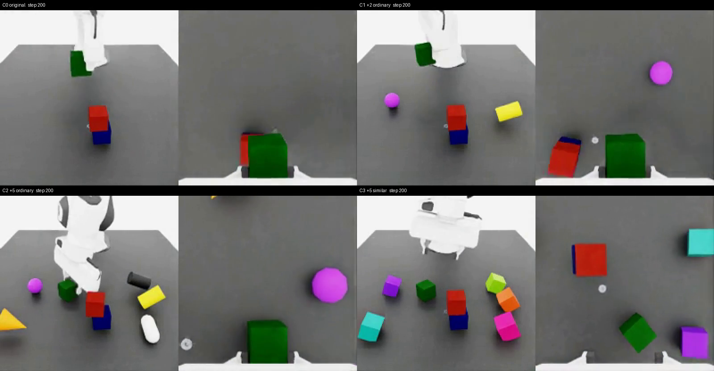
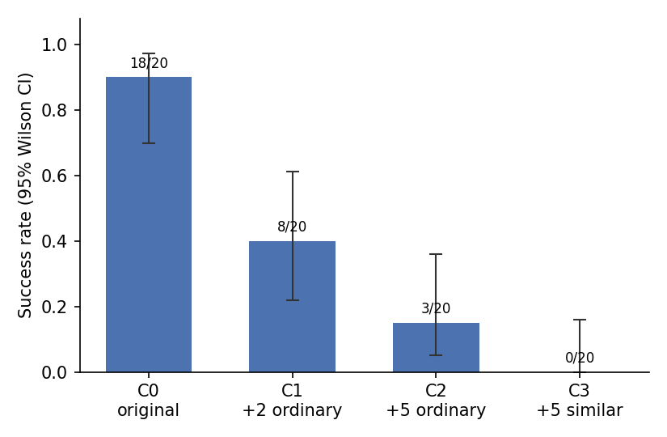

# Visual Distractors vs. Robot Manipulation Success

A pilot study in Isaac Sim / Isaac Lab on how **visual distractors** affect an **image-based imitation-learning
policy** on a Franka cube-stacking task.

The policy only sees camera images plus proprioception, never object poses. We add distractor objects that change
the images but not the physics, and we compare success over **paired** episodes: the same initial states in every
condition.



*Seed 1000 at step 200, with each tile showing the table camera and the wrist camera. Top left is C0 (original), top right C1 (+2 ordinary),
bottom left C2 (+5 ordinary), bottom right C3 (+5 target-similar). Full videos are in [`media/`](media/).*

## Key results

Pilot: 4 conditions × 20 paired episodes (seeds 1000–1019), horizon 800 steps, policy checkpoint at epoch 480.

| Condition | Distractors | Success | Rate (95% Wilson CI) | vs. C0, paired (exact McNemar) |
|---|---|---|---|---|
| C0 | none | 18/20 | **0.90** (0.70–0.97) | – |
| C1 | 2 ordinary objects | 8/20 | **0.40** (0.22–0.61) | 10 lost, 0 gained, p = 0.002 |
| C2 | 5 ordinary objects | 3/20 | **0.15** (0.05–0.36) | 15 lost, 0 gained, p = 0.0001 |
| C3 | 5 target-similar cubes | 0/20 | **0.00** (0.00–0.16) | 18 lost, 0 gained, p < 0.0001 |



Failure breakdown (episode counts):

| | Wrong object | Cube dropped | Timeout: green not grasped | Timeout: green not stacked | Timeout: red not stacked |
|---|---|---|---|---|---|
| C0 | 0 | 0 | 0 | 2 | 0 |
| C1 | 0 | 4 | 0 | 8 | 0 |
| C2 | 1 | 3 | 3 | 9 | 1 |
| C3 | 5 | 1 | 4 | 10 | 0 |

Findings:

- **Images alone cause the drop.** Distractors have no collision, so every lost episode comes from the change in
  the images.
- **More distractors, more failures.** Success falls monotonically as distractors are added: 90% → 40% → 15%.
  Target-similar cubes do the most damage (0%).
- **Every pair goes C0's way.** No seed succeeds with distractors while failing without them.
- **Failures happen in the second half.** The first sub-task (red cube onto blue) is completed in 79 of 80
  episodes. The policy then fails to grasp or place the green cube.
- **Similar cubes attract the gripper.** Gripper-closing near a distractor ("wrong object") occurs mostly with
  similar cubes (5 episodes in C3).

## Experimental design

| | |
|---|---|
| Task | `IsaacContrib-Stack-Cube-Franka-IK-Rel-Visuomotor` (Isaac Lab 3.0): stack red on blue, then green on red |
| Policy | robomimic BC-RNN-GMM, ResNet18 + SpatialSoftmax encoders |
| Observations | `table_cam` + `wrist_cam` RGB (200×200), `eef_pos`, `eef_quat`, `gripper_pos` (no object poses) |
| Training data | 1000 demos generated with Isaac Lab Mimic from the official Franka stack teleop dataset |
| Episodes | 20 per condition; episode *i* uses seed 1000+*i* in every condition |
| Fixed across conditions | cameras, lighting, textures, targets, horizon (800 steps) |

**Distractors** ([`envs/distractors.py`](envs/distractors.py)):

- **Purely visual.** Distractors are kinematic and collision-free, so they change the images and nothing else.
- **Placed out of the way.** Distractors sit in two side bands (x ∈ [0.35, 0.60] m, |y| ∈ [0.15, 0.22] m) next to the
  cube workspace (|y| ≤ 0.10 m), at least 8 cm apart. That keeps them off the manipulation path, and they never
  occlude the targets from the table camera.
- **Ordinary set.** A yellow cylinder, purple sphere, orange cone, white capsule and black cylinder.
- **Target-similar set.** Cubes of the same size as the targets, in orange-red, violet, teal, crimson and
  yellow-green. The targets remain the only pure red, blue and green cubes, so the task is still uniquely specified.
- **Layout is seeded separately.** The layout comes from its own RNG seeded with the episode seed. Cube poses and
  joint noise are therefore identical across conditions.

**Outcome labels**:

| Label | Meaning |
|---|---|
| `success` | The task's `cubes_stacked` success term fired. |
| `manipulation_drop` | A cube fell off the table (termination term). |
| `wrong_object` | Heuristic: the gripper commanded closed with the end-effector below 8 cm and within 4 cm (xy) of a distractor. |
| `timeout_fail_<stage>` | The episode timed out. The stage is the furthest sub-task reached. |

## Repository layout

```
configs/bc_rnn_image.json      robomimic config (Isaac Lab bc_rnn_image_200.json, num_data_workers 4 -> 12)
envs/distractors.py            distractor objects, placement and reset event
scripts/
  smoke_test.py                launch the env, save camera frames (installation check)
  train.py                     wrapper around Isaac Lab's robomimic train.py using configs/bc_rnn_image.json
  eval_distractors.py          paired evaluation of one condition (CSV, summary, videos; resumable)
  run_eval_resilient.sh        reruns eval_distractors.py until all episodes are done (restart after a drop)
  run_pilot.sh                 full pilot: C0-C3, then analysis and media
  analyze.py                   success rates, Wilson CIs, failure breakdown, paired McNemar tests, figure
  make_media.py                labelled 2x2 comparison videos into media/
results/
  pilot_e480/                  main results: summary_all.csv, failure_breakdown.csv, paired_tests.json,
                               success_rates.png, eval_C*/episodes.csv + summary.json
  checkpoint_selection/        C0 success of epochs 100-480 (used to pick epoch 480)
  layout_preview/              first frames of C2/C3 layouts (seeds 1000-1002)
media/                         comparison videos (grid) and per-condition clips for seeds 1000, 1001, 1003
```

Not tracked (see `.gitignore`):
- `data/`: about 21 GB of HDF5 datasets.
- `checkpoints/`: 140 MB per checkpoint.
- `logs/`.
- Per-episode videos in `results/**/videos/`.

## Reproducing

### 1. Environment

Tested on Ubuntu 24.04, RTX 5090 (32 GB), driver 595.99, CUDA 13.2. The software stack is Isaac Sim 6.2.0 and
Isaac Lab v3.0.0, with Python 3.12, torch 2.11.0+cu130 and robomimic 0.4.0.

> Isaac Sim 5.1 crashed (`librtx.scenedb` segfault) on this Blackwell GPU with the 595 driver, so 6.2 is used.
> Isaac Lab 3.0 changed APIs: launch through `launch_simulation`, headless is the default, the task was renamed, and
> data is accessed through `.torch`. The scripts here target 3.0.

```bash
git clone --branch v3.0.0 https://github.com/isaac-sim/IsaacLab.git ~/isaac/IsaacLab
cd ~/isaac/IsaacLab
export UV_PROJECT_ENVIRONMENT=~/isaac/env_isaaclab OMNI_KIT_ACCEPT_EULA=YES
uv sync --extra isaacsim --extra mimic
source ~/isaac/env_isaaclab/bin/activate
export ISAACLAB_PATH=~/isaac/IsaacLab
```

The commands below assume this environment is active and are run from the repository root.

```bash
python scripts/smoke_test.py   # should save camera images and a summary to results/smoke_test/
```

### 2. Data

Download the official Franka stack teleop dataset (10 demos) from NVIDIA:
<https://omniverse-content-production.s3-us-west-2.amazonaws.com/Assets/Isaac/5.1/Isaac/IsaacLab/Mimic/franka_stack_datasets/dataset.hdf5>.
Save it as `data/franka_stack_dataset.hdf5`, then:

```bash
M=$ISAACLAB_PATH/scripts/imitation_learning/isaaclab_mimic
python $M/annotate_demos.py --task Isaac-Stack-Cube-Franka-IK-Rel-Visuomotor-Mimic-v0 --auto \
    --input_file data/franka_stack_dataset.hdf5 --output_file data/annotated_dataset.hdf5
python $M/generate_dataset.py --num_envs 100 --generation_num_trials 1000 \
    --input_file data/annotated_dataset.hdf5 --output_file data/generated_dataset_1000.hdf5
```

### 3. Training

The trained checkpoints are not released, so the policy has to be trained locally. The run below trains 600 epochs × 500 steps and saves a checkpoint every 20 epochs.

```bash
python scripts/train.py --task IsaacContrib-Stack-Cube-Franka-IK-Rel-Visuomotor --algo bc \
    --dataset data/generated_dataset_1000.hdf5 --log_dir $PWD/checkpoints/bc_rnn_image
```

### 4. Evaluation

```bash
# preview distractor layouts (no policy)
python scripts/eval_distractors.py --condition C3 --preview --num_episodes 3 --run_name layout_preview

# one condition
python scripts/eval_distractors.py --condition C2 --checkpoint <model_epoch_480.pth> --run_name pilot

# full pilot (C0-C3 x 20 episodes) + analysis + media
scripts/run_pilot.sh <model_epoch_480.pth> pilot 20
python3 scripts/analyze.py results/pilot
```

## Limitations

- **Single source demo.** Only 1 of the 10 official demos replayed cleanly during annotation on Isaac Sim 6.2. All
  1000 generated demos therefore derive from that one source demo, so the policy has seen little visual and
  behavioural variety. This likely makes it more sensitive to distractors than a policy trained on diverse data.
- **Incomplete training.** Training was interrupted at about epoch 480 of 600. The checkpoint was chosen on C0
  with 6 episodes each, on seeds 1000–1005, which overlap the pilot seeds:

  | Epoch | 200 | 300 | 400 | 480 |
  |---|---|---|---|---|
  | C0 success | 0/6 | 3/6 | 1/6 | 5/6 |
- **Small sample.** n = 20 per condition is a pilot, so the confidence intervals are wide.
- **Non-deterministic physics.** GPU PhysX is not bit-exact. Pairing fixes the initial state but not the full
  trajectory, so a rerun of the same seed can end differently.
- **Approximate failure labels.** `wrong_object` is a geometric heuristic, not a contact check.
- **Evaluation workaround.** After a real cube drop, the simulator could stay in a corrupted state that
  `env.reset()` did not clear. Later episodes in that process then "dropped" within 3 steps. To avoid this,
  `eval_distractors.py` exits after every drop, and `run_eval_resilient.sh` restarts it, resuming from
  `episodes.csv`. Drops within 5 steps are discarded and rerun. All reported results use this procedure.

## Acknowledgements and licenses

- [Isaac Lab](https://github.com/isaac-sim/IsaacLab) (BSD-3-Clause) provides the task, the Mimic data-generation
  pipeline and the robomimic training scripts and config.
- [Isaac Sim](https://developer.nvidia.com/isaac/sim) is subject to the NVIDIA Isaac Sim license and EULA.
- The Franka stack teleop dataset is an NVIDIA Isaac Lab asset and is not redistributed here.
- [robomimic](https://github.com/ARISE-Initiative/robomimic) (MIT) provides the BC-RNN-GMM algorithm and the visual
  encoders.
